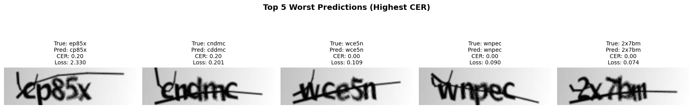

# Captcha OCR Recognition

Решение финального задания по курсу **Deep Learning Basic**. В рамках проекта реализована
сверточно-рекуррентная нейронная сеть (CRNN) для распознавания текстовых символов
на зашумлённых изображениях капчи.

**Итоговый результат:** Validation CER **0.19%**, Full Match Accuracy **99.07%**
(213 из 214 капч распознаны без единой ошибки).

## 🛠 Структура проекта
```text
DL project/
├── data/
│   └── samples/            # Папка с исходным датасетом капчи (.png, .jpg)
├── utils/
│   ├── __init__.py         # Точка сборки пакета и унификации импортов
│   ├── config.py           # Константы, гиперпараметры, словари токенизации и DEVICE
│   ├── dataset.py          # Класс CaptchaDataset и потокобезопасные DataLoader'ы
│   ├── model.py            # Архитектура AdvancedCRNN (VGG-style CNN + Bi-LSTM + FC)
│   ├── train.py            # Цикл обучения, валидации и сохранения весов
│   ├── metrics.py          # Метрика посимвольной ошибки calculate_cer
│   ├── visualization.py    # Визуализация ошибок (топ-5 худших)
│   └── analytics.py        # Статистический анализ ошибок
├── weights/
│   └── best_model.pth      # Файл весов лучшей обученной модели
├── captcha_ocr.ipynb                  # Ноутбук (обучение + пост-анализ), запуск на CPU
├── captcha_ocr_GoogleColab.ipynb      # Ноутбук (обучение + пост-анализ), запуск на Google Colab
└── README.md               # Документация проекта

```

## Архитектура модели (AdvancedCRNN)

Модель объединяет три концепта для задач распознавания текста (OCR):

1. **Feature Extractor (CNN):** VGG-style сеть (4 сверточных блока с `BatchNorm2d`,
   `ReLU` и `MaxPool2d`). Первые два блока сжимают и высоту, и ширину; третий
   и четвёртый — только высоту. Выход: карта признаков `(B, 512, 2, 35)` —
   по одной колонке на каждый шаг времени.
2. **Sequence Predictor (RNN):** двунаправленная 2-слойная **Bi-LSTM**
   (`hidden_size=256`), работающая по всем 35 колонкам карты признаков
   и анализирующая контекст слева направо и справа налево.
3. **Classifier (FC):** полносвязный слой классифицирует каждую колонку,
   после чего блоки из 7 соседних колонок усредняются в логиты одного символа
   (35 колонок → 5 символов капчи).

Ключевое проектное решение — **сжатие временной оси выполняется после
классификации, а не до RNN** (см. «Эволюция архитектуры»).

## Анализ итоговых результатов финальной модели 

Наилучшая модель (эпоха 30, CER 0.0019) на валидационном наборе: **212 из 214 капч
распознаны целиком, 2 изображения — с одной ошибкой в символе** (посимвольная
ошибка 0.19%, Full Match 99.07%).

**Все ошибки финального прогона:**

| № | Истинный текст | Предсказано | CER | Позиция ошибки | Замещение |
|---|---|---|---|---|---|
| 1 | `ep85x` | `cp85x` | 0.20 | 1 | `e → c` |
| 2 | `cndmc` | `cddmc` | 0.20 | 2 | `n → d` |

**Распределение ошибок по позициям (всего 2 ошибки):**
Позиция 1: 1 (50%) · Позиция 2: 1 (50%) · Позиции 3–5: 0.

**Матрица путаницы (полная, не топ):** `e → c` (1), `n → d` (1).

*Примечание:* в отчёте визуализации в «ТОП-5 худших» попали три примера
с CER 0.00 и полностью совпадающими предсказаниями (`wce5n`, `wnpec`, `2x7bm`) —
это дефект фильтра в `visualization.py`, который отбирает по loss без отсечения
корректных предсказаний (см. «Перспективные улучшения»). Реальных ошибок — 2.

### Топ-5 худших предсказаний



Все пять капч визуально схожи по типу зашумления: поверх текста проходит длинная
прямая штриховая линия (strike-through), частично перекрывающая символы. При этом
ошибочны только два примера — и в обоих линия (или соседний символ) задевает
именно ту деталь, которая отличает букву:

**Ошибка 1: `ep85x` → `cp85x` (`e → c`, позиция 1).** Разница между `e` и `c` —
замкнутая верхняя петля и средняя горизонтальная перекладина. Штриховая линия
на изображении проходит как раз по верхней части первого символа: после наложения
и последующего размытия в свёртках петля `e` сливается с линией, силуэт становится
открытым справа — модель «честно видит» `c`.

**Ошибка 2: `cndmc` → `cddmc` (`n → d`, позиция 2).** Символы в этой капче стоят
вплотную и местами соприкасаются. У `d`, стоящего справа от `n`, есть высокий
вертикальный выносной штрих (ascender); при слиянии силуэтов этот штрих
«достраивается» к правой стойке `n`, и пара из дуги и вертикали начинает читаться
как `d`. Это случай наложения соседних символов — информационный потолок, когда
пиксель физически нельзя однозначно отнести к одной из букв.

**Почему остальные три примера распознаны верно, хотя зашумлены так же:** линия
проходит по частям символов, которые не являются их различающими признаками.
Например, в `wnpec` — капче, которую ломали обе промежуточные версии модели —
штрих задевает верх `w` и `n`, но не их ключевые геометрические детали. Это же
подтверждает порядок в таблице: чем ближе линия к различающему признаку,
тем выше loss (2.33 → 0.20 → 0.11 → 0.09 → 0.07).

**Связь с гипотезой этапа 2:** визуальная разметка худших примеров даёт то, что
не было сделано количественно — у 2 из 2 реальных ошибок зашумление приходится
на различающую деталь символа (перекрытие штриховой линией или соседним символом).
Гипотеза о наложениях подтверждается для остаточных ошибок: они объясняются
не архитектурой, а физикой изображений.

**Интерпретация:** по сравнению с промежуточной версией (34 ошибки на GPU,
76 на CPU) остаточный уровень — 2 ошибки на 1070 символов — соответствует уровню
шума. Дальнейшее улучшение требует не архитектуры, а новых данных или
количественной разметки наложений.

## Эволюция архитектуры

### Этап 1. Проблемы первых запусков

1. **Зависание точности на ~10% и взрыв градиентов.** Точность застывала
   на значении 10.27% и не двигалась. Диагностика: взрыв градиентов в LSTM.
   Решение: `torch.nn.utils.clip_grad_norm_(model.parameters(), max_norm=1.0)`
   в тренировочном цикле. После этого обучение стабилизировалось.
2. **Подбор скорости обучения.** lr = 0.005 давал быстрые, но шумные прогоны
   с сильными всплесками валидации; lr = 0.001 в сочетании с исправлением
   архитектуры дал стабильную сходимость и лучший итоговый результат —
   вопреки ожиданию, что «больше lr = быстрее выучится».
3. **Иллюзия высокой точности (математика метрик).** В старой версии метрика
   `Accuracy = 1.0 − CER` считалась посимвольно: на первой эпохе она показывала
   7.38% «угаданных букв», хотя ни одна капча не была распознана целиком.
   Введена честная метрика Full Match: `(preds == targets).all(dim=1)` —
   «всё или ничего» по всей строке из 5 символов.

Эти исправления подняли результат до CER 3.18% / Full Match 88.32% — но не сняли
главного симптома: доминирующей путаницы `m ↔ n` и концентрации ошибок
на позициях 3–4.

### Этап 2. Диагностика: почему ошибки бьют по центру

На промежуточной версии распределение ошибок по позициям имело «купол»:
на позициях 3–4 приходилось до 67% всех ошибок (GPU), а пара `m ↔ n` давала
53% всех ошибок (13 + 5 из 34). Возможное объяснение — физика зашумлённых капч:

- **Рецептивное поле свёрток «замывает» соседей.** К четвёртому блоку CNN каждый
  вертикальный столбец фичей «видит» уже соседние символы. Для краёв (позиции 1 и 5)
  часть контекста просто отсутствует — сосед с одной стороны, и размывание влияет
  меньше. Для центра наложение действует с двух сторон сразу, и признаки позиций 3–4
  сильнее перепутываются с признаками 2 и 5.
- **Размытие убивает именно тот признак, который отличает m от n.** Разница между
  этими буквами — одна тонкая вертикальная черта. Blur размазывает её до уровня фона,
  и после MaxPool она либо теряется вовсе, либо выживает с малой энергией: модель
  честно «видела n» — отличимой черты m в сигнале почти не осталось.
- **Наложение символов — неоднозначность разбиения.** Когда штрихи двух символов
  пересекаются, даже человек иногда не может однозначно отнести пиксель
  к той или другой букве.

*Замечание о честности:* количественная проверка гипотезы (доля m/n-ошибок,
приходящихся на перекрывающиеся или размытые фрагменты) на этом этапе не
проводилась — эксперимент следующего этапа разрешил вопрос раньше проверки.

### Этап 3. Развилка: два пути улучшения

**Путь A — тюнинг модели (lr, слои, голова).** Плюсы: быстро проверяется,
не требует новых данных. Минусы: если информация потеряна на входе (размытие),
тюнинг лишь маскирует симптом.

**Путь B — блок устранения шума (deblur / unsharp mask) между входом и CNN.**
Плюсы: лечит причину на уровне сигнала, особенно для пар m↔n. Минусы: усложняет
пайплайн, добавляет гиперпараметров — а гипотеза о размытии ещё не была подтверждена.

**Решение:** сначала проверить дешёвую гипотезу — убрать глобальное перемешивание
времени в голове модели (Путь A, одна строка в forward). Логика: если путаница m↔n
исчезнет на тех же капчах, её источник — архитектура, а не шум; эксперимент дешевле
и диагностичнее, чем сразу строить пайплайн предобработки.

### Этап 4. Исправление и вердикт по гипотезе

В исходной версии между CNN и LSTM стоял слой `nn.Linear(35, 5)`, сжимавший
временную ось до рекуррентного блока: каждый из 5 входных векторов LSTM был
линейной комбинацией **всех 35 колонок** изображения. Признаки каждого символа
глобально перемешивались со всеми соседними, а Bi-LSTM получал всего 5 уже
«смешанных» шагов — моделировать локальный контекст было нечем.

Слой `proj` удалён: LSTM читает все 35 колонок по одной, FC классифицирует каждую
колонку, и лишь затем блоки по 7 соседних колонок усредняются в ответ для одного
символа. Сжатие стало локальным (7 колонок → 1 символ), а не глобальным.

Сравнение прогонов (валидация: 214 изображений × 5 символов = 1070 позиций):

| Конфигурация | Val CER | Full Match | Ошибки на поз. 3–4 | Доля m↔n |
|---|---|---|---|---|
| proj до RNN, lr 0.005 (GPU) | 3.18% | 88.32% | 67.7% | 53% |
| proj до RNN, lr 0.005 (CPU) | 7.10% | 76.64% | 55.3% | 33% |
| proj удалён, lr 0.001 (GPU) | **0.19%** | **99.07%** | **0%** | **0%** |

Купольный профиль и путаница m↔n исчезли одновременно — два независимых симптома
одной проблемы. **Вердикт:** гипотеза «ошибки вызваны физическим размытием входа»
не подтвердилась как главная причина — доминирующие ошибки оказались артефактом
глобального перемешивания признаков, и Путь B не потребовался. Гипотеза о наложениях
остаётся актуальной только для остаточных ошибок (на финальном прогоне их 2: `e→c`
и `n→d`); количественная разметка наложений — в списке перспективных улучшений.

### Этап 5. Финальные результаты обучения

**Прогон (GPU, NVIDIA T4):**

- Adam, lr = 0.001; `ReduceLROnPlateau` (patience=5, factor=0.5) — реактивный
  планировщик, снижающий lr при плато валидационного лосса;
  `clip_grad_norm_(max_norm=1.0)`.
- Лучшие метрики достигнуты на **эпохе 30** (CER 0.0019, Full Match 99.07%);
  последняя эпоха из 80 (CER 0.0028) оказалась **хуже** лучшей — наглядная
  иллюстрация, почему чекпоинт отбирается по валидационной метрике,
  а не «что вышло в конце».

**Динамика обучения (характерные фазы):**

1. Эпохи 1–9 — обучение «локализации»: сеть учит, какая колонка карты признаков
   относится к какому символу. Val CER ~0.85–0.42, Full Match близок к 0.
2. Эпохи 9–25 — перелом и скачок: после того как train CER опускается ниже ~0.05,
   Full Match каскадно растёт (34% → 65% → 88%).
3. Эпохи 25–30 — срезка lr планировщиком и добивание до 98–99%.
4. Эпохи 30+ — плато; дальнейшие эпохи не улучшают результат.

### CPU vs GPU на промежуточной версии

На версии с Linear-проекцией при фиксированном seed (`manual_seed(42)`) зафиксировано
расхождение метрик между устройствами: CER 3.18% / Full Match 88.32% (GPU, NVIDIA T4)
против CER 7.10% / 76.64% (CPU). Разница статистически значима (n=214: 50 против 25
капч с ошибками, χ² ≈ 9–10, p < 0.005).

**Причина:** аппаратный недетерминизм параллельных вычислений. Библиотеки cuDNN (GPU)
и MKL (CPU) по-разному оптимизируют порядок операций; микроокругления `float32`
меняют порядок сложения градиентов, что в рекуррентных слоях накапливается вдоль
длины последовательности и уводит траектории Adam в разные минимумы. `manual_seed`
гарантирует воспроизводимость в рамках одного устройства и окружения, но не между ними.

**Характер ошибок отличался:** на CPU — грубые геометрические подмены (зеркальный
переворот m→w, путаница непохожих текстур c→x) и полные «съезды» предсказания
(в топ-худших — капчи с CER 1.0, где не совпал ни один символ); на GPU — локальные
ошибки (совпадали 2–4 символа из 5), сконцентрированные на паре m↔n. Обе версии
сходились к одной и той же систематической путанице m/n — что и подвело к поиску
причины в архитектуре, а не в оптимизации.

## Перспективные улучшения

- **Early stopping** (patience ~10 эпох по val CER) — сократит обучение с 80
  до ~40 эпох.
- **CTC-loss** вместо головы с фиксированной длиной: снимет ограничение
  «ровно 5 символов» (каноничное решение для CRNN-OCR).
- **Количественная разметка наложений** на ошибках m/n — для остаточных ошибок
  и при расширении датасета; при подтверждении — блок unsharp mask на входе
  и аугментации с наложениями/blur.
- **Регуляризация:** dropout в LSTM, weight decay, label smoothing — актуально
  при расширении датасета.
- **Валидация на свежих данных:** контрольный набор капч, которых модель никогда
  не видела (в идеале — с другими параметрами шума).
- **Фикс дефекта визуализации:** фильтр «картинки с ошибками» в `visualization.py`
  пропускает корректные предсказания (сортировка по loss без отбора по CER > 0) —
  топ-5 худших разбавляется успешными примерами.
